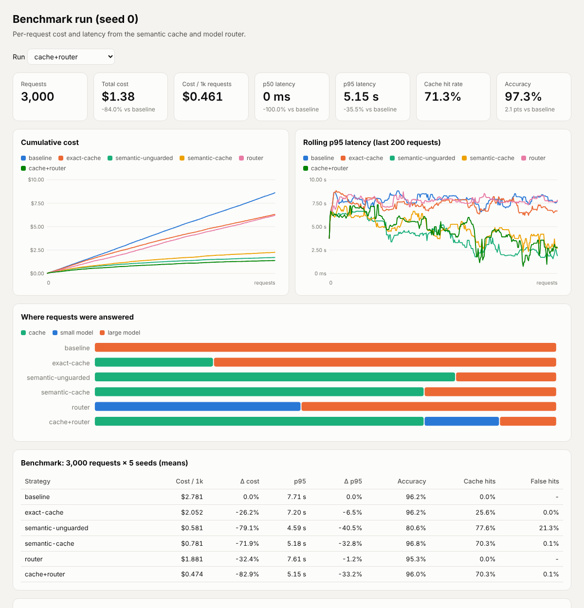

# Semantic cache and cost-aware routing for RAG

A layer that sits in front of the LLMs in a RAG service and decides, per request,
whether it needs to call a model at all and, if so, which one:

1. **Semantic cache.** It reuses a previous answer when a new question means the same
   thing, matched by embedding similarity plus guards that stop look-alike questions
   from sharing answers.
2. **Cost-aware router.** It sends simple lookups to a small, cheap model and
   comparisons, constraint problems and arithmetic to a large model.
3. **Per-request accounting.** Every request is logged with its route, tokens, cost and
   latency breakdown to SQLite, and a dashboard shows cost and p95 latency over time.

## Results

From `python benchmarks/run_benchmark.py`: 3,000 requests × 5 seeds, mean ± std. The models
are simulated, so see [What the benchmark measures](#what-the-benchmark-measures) before quoting
these numbers.

| Strategy | Cost / 1k req | Δ cost | p95 latency | Δ p95 | Accuracy | Cache hit rate | False-hit rate |
|---|---|---|---|---|---|---|---|
| Always large model (baseline) | $2.78 | | 7.71 s | | 96.2% ± 0.7 | | |
| Exact-match cache | $2.05 | −26% | 7.20 s | −6% | 96.2% ± 0.8 | 25.6% | 0.0% |
| Semantic cache, similarity only | $0.58 | −79% | 4.59 s | −41% | **80.6%** ± 1.6 | 77.6% | **21.3%** |
| Semantic cache, guarded | $0.78 | −72% | 5.18 s | −33% | 96.8% ± 0.6 | 70.3% | 0.1% |
| Router only | $1.88 | −32% | 7.62 s | −1% | 95.3% ± 0.5 | | |
| **Guarded cache + router** | **$0.47** | **−83%** | **5.15 s** | **−33%** | **96.0% ± 1.0** | 70.3% | 0.1% |

What this shows:

- **A naive semantic cache is dangerous.** On similarity alone, 21% of cache hits returned
  the answer to a different question, for example "storage on Pro" answered with "storage on
  Business". Accuracy dropped 15.7 points. The guards cut false hits to 0.1% and keep most
  of the savings.
- **Semantic matching beats exact matching.** Hit rate is 70% vs 26%, because real users add
  greetings, sign-offs and small rewordings.
- **The router alone saves cost but not tail latency.** Its p95 stays high because the slow
  requests are the hard ones, and those still go to the large model. The cache is what moves
  p95.
- **Together**, cost per request falls 83% and p95 latency 33%. Accuracy stays within noise
  of the baseline (−0.3 pts, std 1.0).

Full tables, including cache and router threshold sweeps, are in
[`benchmarks/results/results.md`](benchmarks/results/results.md). The raw numbers are in
`results.json`, and the per-request dashboard for seed 0 is
[`benchmarks/results/dashboard.html`](benchmarks/results/dashboard.html).



## How it works

```
query ─► embed ─► retrieve top-k docs ─► cache lookup ──hit──► cached answer   (≈1 ms, ~$0)
                                              │
                                             miss
                                              ▼
                                   router: complexity score
                                     │                  │
                               < threshold         ≥ threshold
                                     ▼                  ▼
                                small model        large model ─► answer ─► cache.add
                                              │
                         every request ─► MetricsStore (SQLite) ─► /dashboard
```

### Semantic cache (`src/ragroute/cache.py`)

A cached answer is reused only if **all four** checks pass:

| Check | Why |
|---|---|
| Cosine similarity ≥ threshold (default 0.80) | the questions are worded alike |
| **Key terms equal**: numbers and entity names, learned from the corpus as words written capitalised mid-sentence | "Pro" vs "Business", or "12 seats" vs "30 seats", embed almost identically but need different answers |
| **Topic overlap** ≥ 0.6: Jaccard over the query words that also appear in the knowledge base | filler like "Hey team … thanks in advance" inflates similarity between "Pro vs Business on *storage*" and "… on *version history*" |
| **Context overlap** ≥ 0.5: Jaccard over the retrieved document ids | never reuse an answer that retrieval would now ground in different documents |

Entries have a TTL and are evicted least-recently-used once `max_entries` is reached.
`ExactMatchCache` is the baseline.

### Router (`src/ragroute/router.py`)

The router is a logistic score over cheap features that are known before any LLM call:
how many entities the question names, comparison words, aggregation words ("total",
"annual"), constraint words ("need", "must", "if"), reasoning words, numbers, length, and
whether several retrieved documents score close to the top one. The default weights are
set by hand. `ComplexityRouter.fit()` re-fits them by logistic regression on labelled
traffic. On this workload the default weights route 97% of requests to the right tier.
The threshold is the cost/quality dial; see the sweep in `results.md`.

### Accounting and dashboard (`metrics.py`, `dashboard.py`, `api.py`)

Each request logs its route, similarity, complexity score, input and output tokens, cost,
and the latency split into embed, retrieve, cache and LLM. `summarize()` gives p50, p95 and
p99, hit rate, accuracy and a per-route breakdown. The dashboard is one self-contained HTML
page with no external assets. It shows KPI tiles with deltas against the first run,
cumulative cost and rolling p95 per run, the route mix, and the latest requests. It supports
light and dark themes and has hover tooltips.

## What the benchmark measures

These parts are **real**: the retrieval, the embeddings, the cache with its guards, the
router, the token counts for every prompt, the local compute latency, and the grading.

These parts are **simulated**: the LLM calls. This sandbox has no model weights and no paid
API access, so `SimulatedLLM` stands in for both tiers. It uses explicit assumptions from
`src/ragroute/presets.py`:

| | Small model | Large model |
|---|---|---|
| Price (USD / 1M tokens, in/out) | 0.15 / 0.60 | 3.00 / 15.00 |
| Accuracy on easy / hard questions | 96% / 62% | 98% / 94% |
| Time to first token / per output token | 0.30 s / 8 ms | 0.80 s / 25 ms |

The model is right with that probability. Otherwise it returns a plausible wrong answer, such
as the right fact for the wrong plan or an arithmetic slip. The benchmark therefore measures
what caching and routing do **given** these model characteristics. The absolute numbers move
if you change the assumptions; the mechanisms behind the comparisons do not.

The workload is a fictional SaaS product's docs: 9 documents and 73 question intents, 44 of
them easy and 29 hard. Each intent has 3–5 paraphrases, and every reference answer is
computed from a table. 3,000 requests are drawn with Zipf popularity. Users add greetings,
sign-offs, casing changes and word swaps ("plan" → "tier", "seat" → "user"). **Cache hit rate
depends heavily on how repetitive the traffic is**, and 73 intents is a concentrated support
workload. Expect lower hit rates on long-tail traffic. Accuracy differences under about 1
point are within seed noise, since the cache freezes whichever answer it stored first.

The default `HashingEmbedder` uses only numpy: hashed word, bigram and character-trigram
features with corpus IDF. It catches rewordings, but not synonyms. With
`SentenceTransformerEmbedder` (`pip install .[embeddings]`) the cache matches true
paraphrases as well. The guards matter even more then, because look-alike questions also
score higher.

### Running against real models

```bash
export RAGROUTE_BACKEND=openai-compatible
export RAGROUTE_BASE_URL=https://api.openai.com/v1   # or any compatible endpoint (vLLM, Ollama, ...)
export OPENAI_API_KEY=...
export RAGROUTE_SMALL_MODEL=<small model id>  RAGROUTE_SMALL_PRICE=0.15,0.60
export RAGROUTE_LARGE_MODEL=<large model id>  RAGROUTE_LARGE_PRICE=3.00,15.00
uvicorn ragroute.api:create_app --factory
```

With real models, replace the exact-fact grader with your own evaluation, such as an LLM
judge or human labels. Free-form answers phrase facts in many ways.

## Quickstart

```bash
pip install -e ".[dev]"
pytest                                    # 23 tests
python benchmarks/run_benchmark.py        # ~2.5 min, writes benchmarks/results/
uvicorn ragroute.api:create_app --factory # simulated backend
curl -s localhost:8000/query -H 'content-type: application/json' \
     -d '{"query": "Which has more storage per seat, Pro or Business, and by how much?"}'
open http://localhost:8000/dashboard
```

The simulated backend only knows the benchmark's questions, so the demo API answers
paraphrases from `corpus.py`. Other questions get a fallback answer, but they are still
routed, priced and logged.

## Layout

```
src/ragroute/
  cache.py       semantic cache, guards, exact-match baseline
  router.py      complexity features, logistic router, fit()
  embeddings.py  HashingEmbedder (numpy) and SentenceTransformerEmbedder
  retriever.py   dense top-k retrieval
  llm.py         ModelSpec pricing, SimulatedLLM, OpenAI-compatible client
  service.py     RAGService: embed → retrieve → cache → route → generate → log
  metrics.py     SQLite request log and summaries
  dashboard.py   self-contained HTML dashboard
  api.py         FastAPI app (/query, /api/stats, /dashboard)
  corpus.py      synthetic docs, intents and workload generator
  presets.py     model tiers, simulation assumptions, grader
benchmarks/run_benchmark.py
tests/
```

## License

MIT
